# PRODUCT-AUDIT — 3DGen

Audit tecnico e di prodotto eseguito il **14 ottobre 2026** sul working tree, non sulla
documentazione. Nessun file sorgente è stato modificato, nessun test è stato toccato,
nessun commit è stato eseguito.

Tutti i numeri di questo documento provengono da esecuzioni reali registrate in
`audit-images/metrics_offline.json`, `audit-images/metrics_llm.json`,
`audit-images/metrics_manual.json`. Le immagini sono in `audit-images/` (51 PNG,
3 angolazioni per modello). Niente è stimato o inventato.

**Giudizio in una riga, per chi legge solo questo:** 3DGen è oggi un **prototipo
tecnico solido**, non un MVP. Con un LLM reale, 5 richieste su 8 non producono
nessuna geometria.

---

## 0. Come sono state prodotte le prove

Tre percorsi distinti, tenuti separati apposta:

| Percorso | Come | Che cosa misura |
| --- | --- | --- |
| **offline** | `Session(provider=OfflineProvider(), planner=MockPlanner())` | il planner locale a corrispondenza di parole |
| **llm** | `make_provider('groq')` + `LLMPlanner`, catena di failover reale | la capacità dell'AI vera |
| **manuale** | piani JSON scritti a mano, `Session.build()` | il **tetto del motore**, senza planner |

Rendering: `app.ui.offscreen.render`, contesto standalone moderngl, 760×520, tre
angolazioni (`front` az 0°, `three_quarter` az 38°, `side` az 90°).

Suite di test eseguita durante l'audit: **1213 passed in 58.78s**. Questo dato
è rilevante soprattutto per quanto *non* dice — si veda la sezione 6.

---

## 1. Qualità visiva reale

### 1.1 Tabella riassuntiva, offline contro LLM reale

| # | Prompt | offline: ok / tris / s | LLM: ok / tris / s / provider / failover |
| --- | --- | --- | --- |
| 1 | Volpe cartoon low-poly | ✅ 412 / 0,330 s | ❌ 0 / 3,2 s / groq / 0 |
| 2 | Umanoide testa enorme, gambe corte, mani grandi | ✅ 330 / 0,123 s | ❌ 0 / 68,0 s / cloudflare / 3 |
| 3 | Robot con quattro braccia | ✅ 168 / 0,055 s | ❌ 0 / 2,7 s / groq / 0 |
| 4 | Jeep cartoon con sei ruote | ✅ 56 / 0,058 s | ✅ 56 / 147,4 s / **nessuno** / 9 |
| 5 | Pesce con corpo umanoide | ✅ 1292 / 0,161 s | ✅ 198 / 34,8 s / cloudflare / 3 |
| 6 | Casa alta, slanciata, curva | ✅ 32 / 0,098 s | ❌ 0 / 20,9 s / cloudflare / 3 |
| 7 | Drago con ali, corna, coda | ✅ 82 / 0,054 s | ❌ 0 / 2,6 s / groq / 0 |
| 8 | Albero fantasy, chioma asimmetrica | ✅ 50 / 0,052 s | ✅ 400 / 74,3 s / nvidia_nim / 4 |

Mediana: **0,078 s offline**, **27,9 s con LLM**. Tre successi su otto con AI reale,
e uno dei tre (#4) è un successo solo formale: il piano prodotto è un casco.

**`ok = True` non significa niente di estetico.** Tutti e otto i casi offline sono
`ok = True`. Il prompt «albero fantasy» ha prodotto un'ala e un cristallo; il prompt
«jeep» ha prodotto un casco. Il cancello di qualità ha approvato entrambi.

### 1.2 Caso per caso

#### 1 — Volpe cartoon low-poly

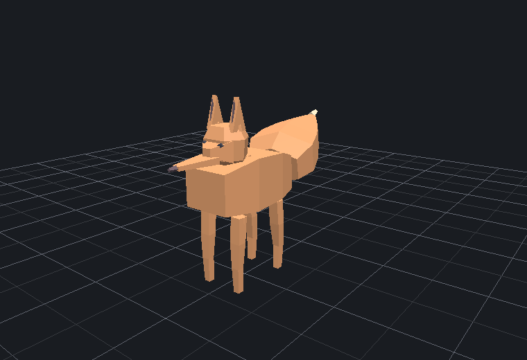
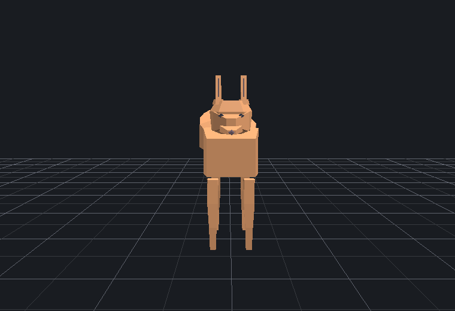
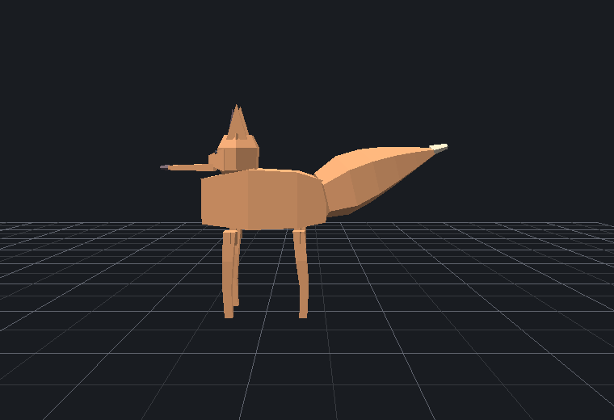

Piano manuale, detail 3: 476 triangoli, 15 nodi, 0,289 s. Componenti:
`fox_stylized:fox / body / head / ears / inner_ear / leg ×4 / tail / tail_tip /
face_accents`.

Vincoli soddisfatti: quadrupede riconoscibile, orecchie a punta, muso allungato,
budget low-poly rispettato, nessun errore geometrico.

Difetti estetici: la coda è una lastra piatta staccata dalla groppa e sospesa in
aria; le quattro zampe sono bastoncini identici senza zampa né rastremazione; il
corpo è una scatola senza torace né cosce; il muso è una lama sottile; la palette
dichiara `fox_orange`, `fox_dark`, `fox_cream`, `fox_eye` ma **il modello usa solo
`fox_orange`** — niente petto chiaro, niente zampe scure. Legge come «quadrupede
generico», non come «volpe cartoon».

Con planner LLM: `ok = False`, 0 triangoli (si veda 2.2).

#### 2 — Umanoide cartoon con testa enorme, gambe corte, mani grandi

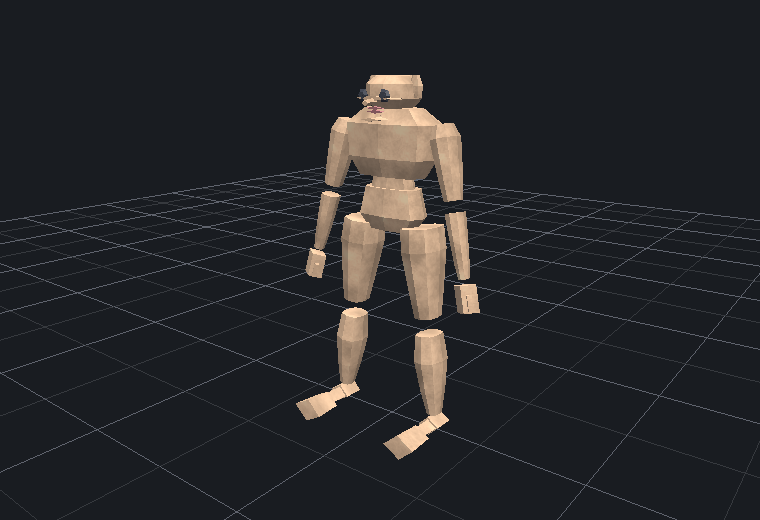
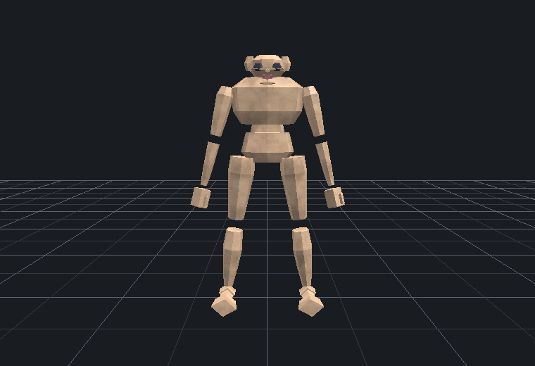
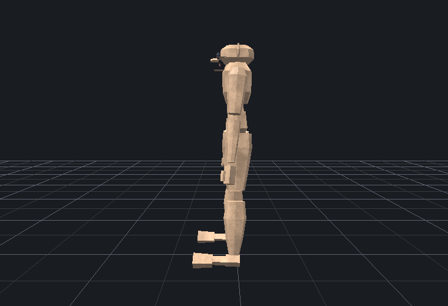

Piano manuale con `std:body_mass = 0.8` e `fx:chunky 0.7`: 1142 triangoli, 37 nodi,
0,141 s. La catena anatomica è corretta e **concatenata**, non a fratelli:
`shoulder → upper_arm → elbow → forearm → wrist → hand`, idem per la gamba.

Vincoli soddisfatti: figura bipede leggibile, simmetria bilaterale corretta (14
componenti presenti due volte, uno per lato), colori applicati, trait semantico
applicato davvero (`body_mass` → `1.0 → 1.21` sul nodo radice).

Vincoli **non** soddisfatti: nessuno dei tre richiesti. La testa non è enorme, le
gambe non sono corte, le mani non sono grandi. Non esiste un trait o un effetto che
esprima «testa enorme»: `body_mass` agisce sulla massa globale, non sulle proporzioni
relative fra parti.

Difetti geometrici visibili: avambracci e mani staccati, sospesi a qualche centimetro
dal gomito; piedi come lastre piatte distaccate dalla caviglia; occhi posizionati
sopra la calotta invece che sul volto; collo invisibile.

#### 3 — Robot con quattro braccia

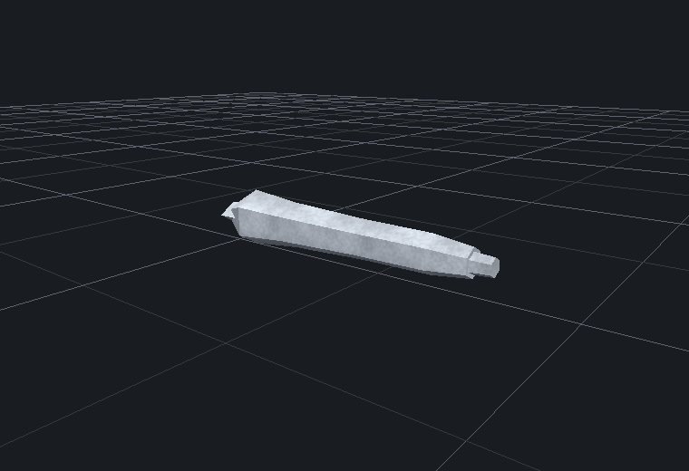
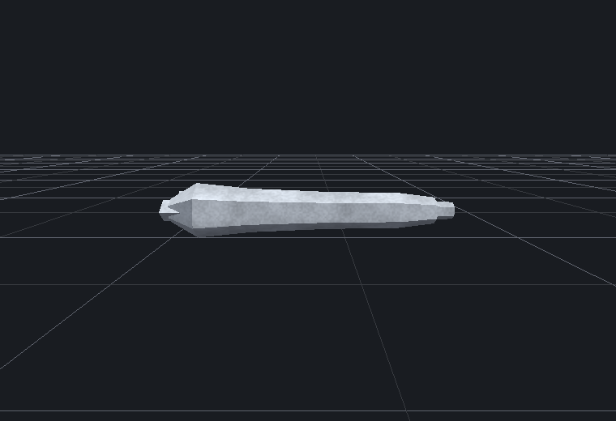
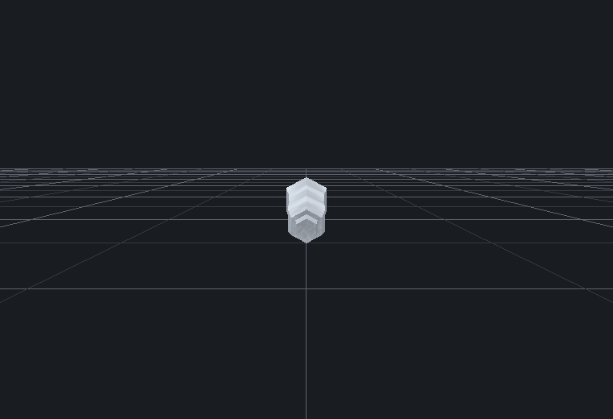

**Non è realizzabile oggi, né a mano né con AI.** Tre barriere indipendenti:

1. Non esiste un corpo robot. Il plugin `robot` fornisce **un solo componente**,
   `robot:head`, dichiarato per lo stile realistico.
2. Lo stile lo rifiuta: `'robot:head' non e' fatto per lo stile 'low_poly'`. Il
   rifiuto è voluto e corretto, ma lascia la richiesta senza risposta.
3. Il trait strutturale `character:arm_count` **non funziona su nessun corpo
   installato** (si veda 3.2): `parent prototype non disponibile: 'corpo/torso'`.

Il piano manuale `m03b_humanoid_4arms` — un umanoide anatomico con
`character:arm_count = 4`, senza robot di mezzo — fallisce comunque: `ok = False`,
0 triangoli.

L'immagine sopra è il meglio che il sistema produce oggi per questo prompt: quattro
pezzi di braccio sconnessi, senza corpo, 168 triangoli, approvati come `ok = True`.

#### 4 — Jeep cartoon con sei ruote

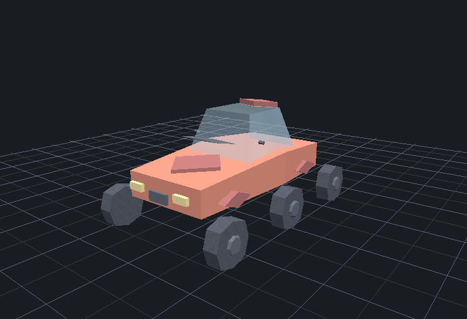
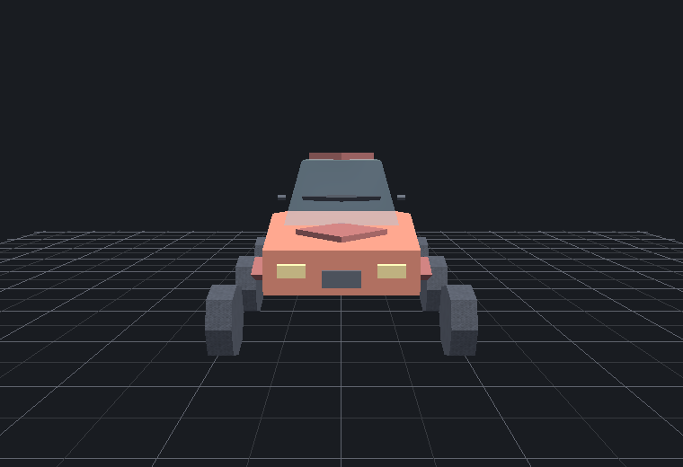
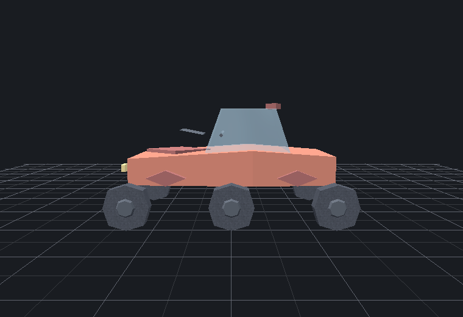

Piano manuale, root `id: "car"`, `vehicle:wheel_count = 6`: 524 triangoli, 28 nodi,
0,095 s, **sei ruote effettivamente create** dal motore di layout.

È il risultato migliore dell'intero audit: veicolo riconoscibile, colorato,
silhouette leggibile, ruote generate e distribuite automaticamente.

Difetti: le sei ruote non sono distribuite in modo simmetrico — la ruota anteriore
sinistra è isolata molto avanti mentre due si addensano sul posteriore destro; il
parabrezza e la cabina sono traslucidi e fluttuano sopra la scocca; lo spoiler è
disallineato; non è una jeep, è una city car (non esiste un componente jeep).

**Il risultato dipende dal nome del nodo.** Rinominando la radice da `car` a `jeep`,
stesso componente, stesso trait:

```text
root id = car   → ok True,  524 tris, 28 nodi, 6 ruote
root id = jeep  → ok False, 0 tris,   0 nodi,  "parent prototype non disponibile: 'car'"
```

Il percorso LLM, con la catena esaurita (failover 9) e ripiego esplicito su
`planner = mock_fallback`, ha prodotto `accessories:helmet`, 56 triangoli,
`ok = True`.

#### 5 — Pesce con corpo umanoide

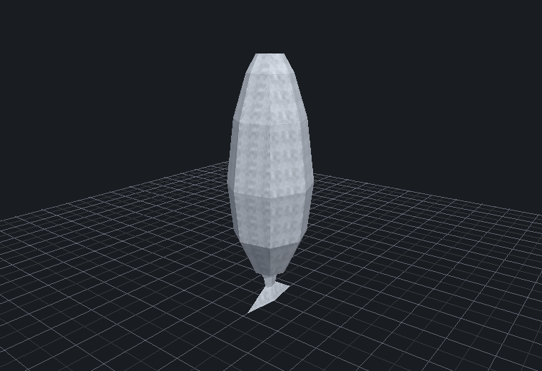
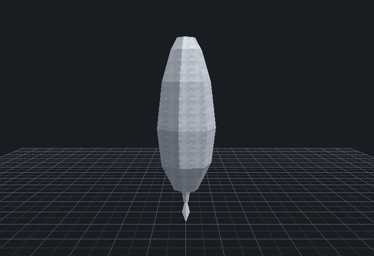
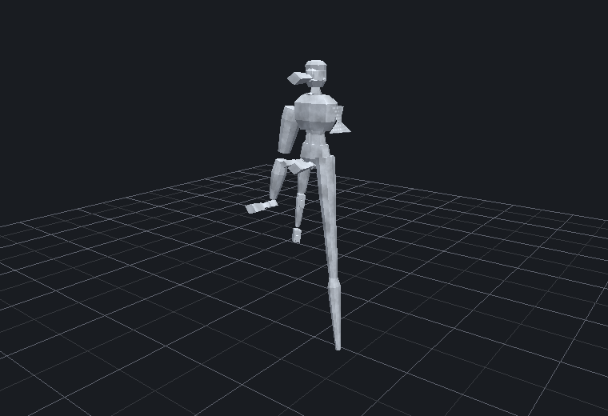

È l'unico prompt in cui l'LLM ha composto parti di **plugin diversi**:
`fish:fish_body` + `humanoid:head` + `fish:tail`, 198 triangoli.

Vincolo non soddisfatto: ha chiesto `core_mount` sul lato `l` di `fish:fish_body`,
che non lo espone — `'fish:fish_body' non ha un innesto per capability 'core_mount'
+ lato 'l'`. La riparazione singola è partita e **non ha migliorato il piano**:
`punteggio 1250 (unresolved=1, attachment=1) prima, 1250 dopo`.

Il percorso offline ha prodotto 1292 triangoli e 40 nodi, con catene di arti
duplicate appese a radici scollegate (`arm`, `shoulder/upper_arm/...`,
`elbow/forearm/...` compaiono tutte come radici separate) — geometria sovrapposta,
approvata `ok = True`.

#### 6 — Casa alta, slanciata e leggermente curva

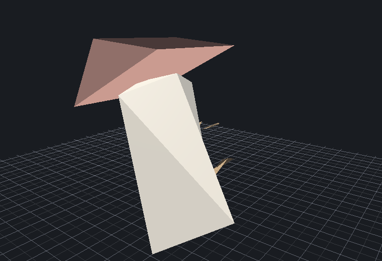
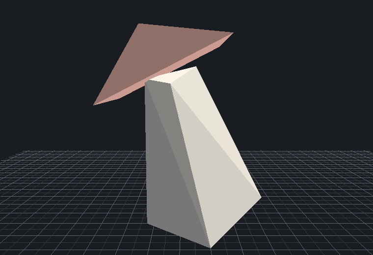
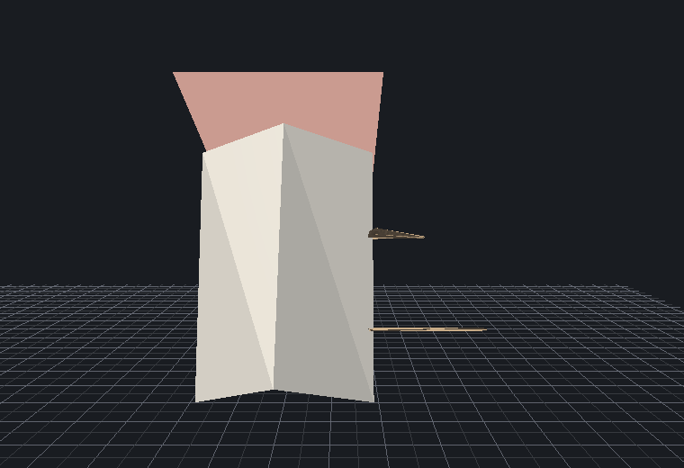

Piano manuale con `fx:lanky 0.8` + `fx:bend 0.3` su `scope: subtree`: 80 triangoli,
5 nodi, `ok = True`.

Questa immagine è la prova più netta che **validità geometrica ≠ qualità estetica**.
Il muro si è allungato e piegato; il tetto non ha seguito la deformazione: è
staccato, inclinato nel verso sbagliato, sovradimensionato e sospeso. Porta e
finestra sono schegge che attraversano la parete. Il referto è vuoto: nessun
errore, nessun avviso.

Con LLM: `ok = False`, l'effetto è stato invocato con un parametro inesistente —
`l'effetto 'fx:bend' non ha un parametro 'params'`.
Nel percorso offline, lo stesso effetto è stato scartato per ambito sbagliato:
`'fx:bend' non si applica a un ambito 'model' — dichiara: part, subtree, group, role`.

#### 7 — Drago cartoon con ali, corna e coda

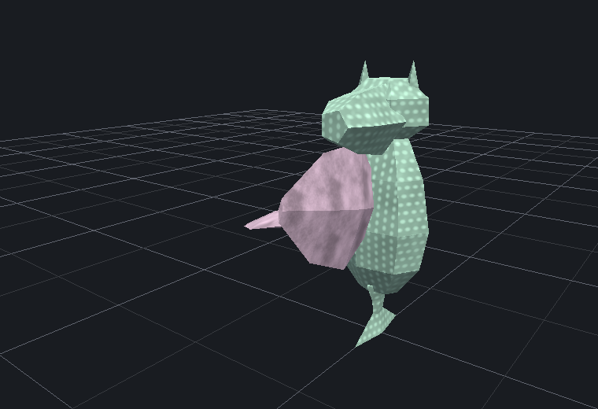
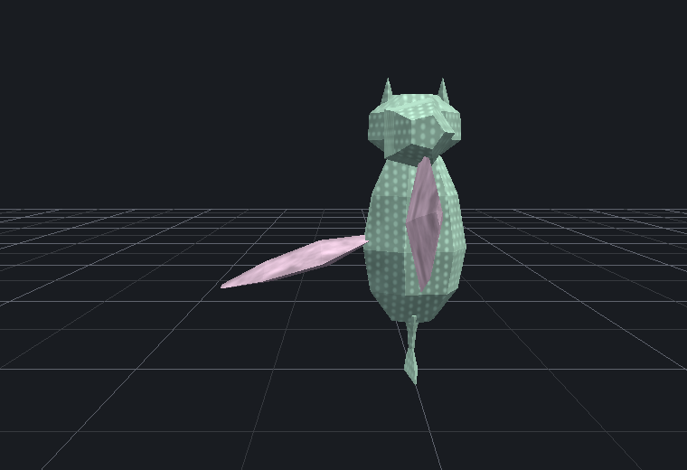
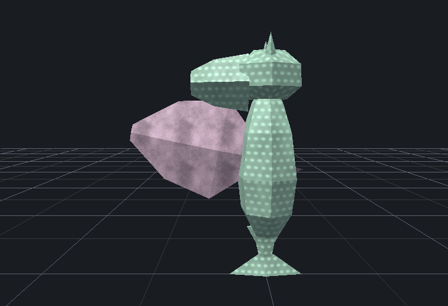

Piano manuale chimera: `fish:fish_body` + `creature:dragon_head` + `fantasy:wing ×2`,
256 triangoli, 5 nodi, `ok = True`.

Testa e corna leggono bene. Tutto il resto no: il corpo di pesce è costruito lungo
**+Y** e il drago finisce **in piedi sulla coda**; le due ali sono collassate nello
stesso punto dallo stesso lato invece di essere speculari; mancano zampe; la coda
richiesta è la pinna caudale del pesce.

Questo è il sintomo di una dipendenza nascosta: `humanoid_anatomical` dichiara nel
manifesto «torso e testa crescono lungo +Y; arti e catene lungo +X; fronte verso +Z»,
ma **la convenzione non è un contratto verificato dal core**. Due plugin con
convenzioni diverse si compongono senza errore e il risultato è orientato male.

Con LLM: `nessuna implementation compatibile per 'drago_cartoon'`, `ok = False`.

#### 8 — Albero fantasy con chioma asimmetrica

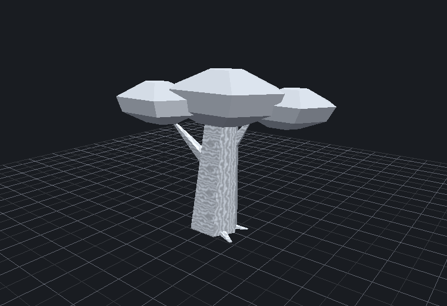
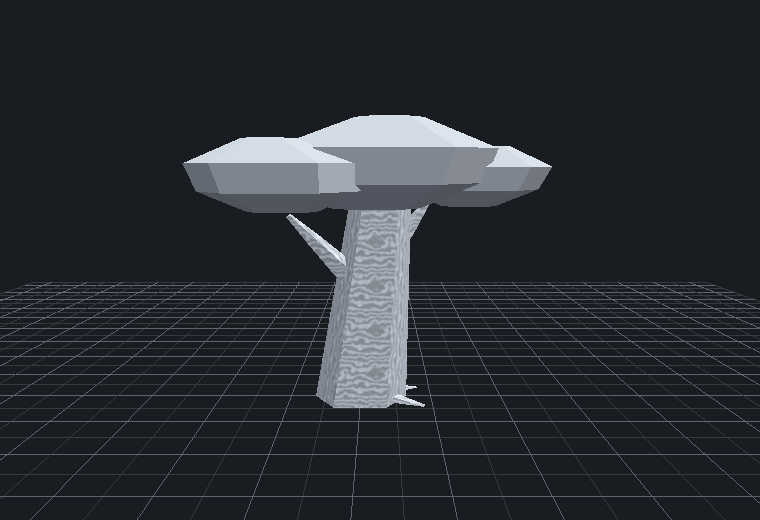
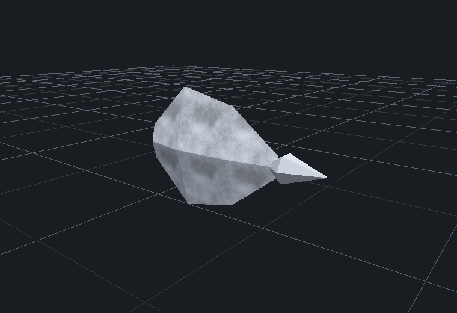

È l'unico successo pieno dell'LLM: `tree_stylized:tree` + trunk + 4 rami + crown,
400 triangoli, 74,3 s, failover 4, piano corretto al primo tentativo.

Difetti: i rami sono spuntoni sottili con angoli arbitrari, uno dei quali esce dal
**fondo** del tronco; la chioma sono tre dischi piatti sovrapposti, non asimmetrici;
il tronco porta una texture procedurale rumorosa che contraddice il linguaggio
low-poly a tinte piatte; il modello è grigio (si veda 1.3).

Il percorso offline, per lo stesso prompt, ha prodotto **un'ala e un cristallo**
(`fantasy:wing`, `fantasy:crystal`), 50 triangoli, `ok = True`.

Nota verificata a parte: il trait `botany:leafiness` **funziona davvero**. A parità
di piano, l'ingombro passa da `[2.718, 2.862, 1.380]` a `[4.244, 3.143, 2.509]`
fra valore 0,0 e valore 1,0.

### 1.3 Un difetto che attraversa tutte le immagini: i modelli escono grigi

`GenerationResult.scene()` ha `registry=None` come valore predefinito, e
`app/build/scene.py:to_scene` senza registry assegna `default_material` a ogni nodo:

```python
materiale = registry.material(costruito.material) if registry is not None \
    else default_material(costruito.material)
```

Il materiale `fox_orange` esiste ed è `#d86b32`; senza registry diventa `#9aa0a6`,
grigio. `Session` passa sempre `self.catalog()` al proprio interno, quindi la UI è
salva, ma **la chiamata ovvia dell'API pubblica — `result.scene()` — restituisce un
modello senza colori**. Tutte le immagini `*_offline_*` e `*_llm_*` di questo audit
lo dimostrano; le immagini `m0*` sono colorate perché il registry è stato passato a
mano.

---

## 2. Capacità effettiva dell'AI

**Il test con provider reale è stato eseguito.** Nessuna chiave è stata letta,
stampata o inclusa in questo documento; i provider sono stati usati attraverso
`make_provider`, e l'unico dato riportato è l'identificativo pubblico del modello.

### 2.1 Il provider primario è inutilizzabile, sempre

Ogni singola generazione dell'audit ha fallito sul primo candidato della catena con
lo stesso errore:

```text
Groq ha risposto 413: Request too large for model `openai/gpt-oss-120b` ...
tokens per minute (TPM): Limit 8000, Requested 8211
```

Il vocabolario inviato al planner misura **39 964 caratteri**, che diventano ~8 200
token di payload. Il limite del piano gratuito Groq è 8 000. Lo sforamento è
**strutturale e permanente**, non un picco: 8 richieste su 8, sia in esecuzioni
separate sia in serie.

Di conseguenza ogni generazione paga il pedaggio del failover:

```text
attempt=1 groq       → 413 payload_too_large
attempt=2 gemini     → 503 server_error
attempt=3 mistral    → 429 rate_limited
attempt=4 cloudflare → invalid_json / ok
```

Latenza risultante: da 2,6 s (fallimento immediato) a **147,4 s** (catena esaurita).
Mediana 27,9 s. Un'app desktop con una mediana di 28 secondi e code da due minuti e
mezzo non è usabile.

La catena di failover, va detto, **funziona come progettato** e registra tutto:
`failover 9`, `planner = mock_fallback`, provenienza completa. Il ripiego non è mai
silenzioso. Questo è un punto di forza reale.

### 2.2 Che cosa l'LLM sa e non sa fare

| Capacità richiesta | Esito | Prova |
| --- | --- | --- |
| Selezionare il plugin giusto | **Sì, quando sceglie un componente** | #1 → `fox_stylized:fox`; #8 → `tree_stylized:tree`; #5 → `fish` + `humanoid` |
| Produrre JSON valido | **Sì** | structured output attivo; nessun errore di parsing JSON se non su un provider (`cloudflare` → `nessun JSON nella risposta`) |
| Scegliere socket coerenti | **No** | #5: `'fish:fish_body' non ha un innesto per capability 'core_mount' + lato 'l'` |
| Interpretare proporzioni | **Non verificabile** | #2 non è mai arrivato alla geometria |
| Interpretare effetti | **No** | #6: `l'effetto 'fx:bend' non ha un parametro 'params'` |
| Interpretare quantità | **Non verificabile** | #3 e #4 non hanno mai raggiunto il livello strutturale |
| Comporre plugin diversi | **Sì, una volta su otto** | #5 |
| Concetti senza archetipo | **No, e in modo fatale** | #3: `concept non registrato: 'robot with four arms'`; #7: `nessuna implementation compatibile per 'drago_cartoon'` |

### 2.3 Il ramo `concept` è una trappola

Quattro fallimenti su cinque passano da lì. L'LLM, vedendo l'indice degli archetipi,
preferisce il ramo `concept` al ramo `root` — e quando l'archetipo non esiste la
generazione **muore**, invece di ripiegare sulla composizione di componenti.

Peggio: nel caso #1 il modello ha scritto

```json
"archetypes": ["registered:archetype_metadata:felid"]
```

inventando il prefisso `registered:`. Il vocabolario mostra correttamente
`archetype_metadata:felid`; il prefisso è un'allucinazione, e il costo è l'intera
generazione. Non c'è normalizzazione degli id, né fallback al ramo `root`.

Lo stesso ramo è inutilizzabile anche a mano: il piano `m01b_fox_concept`, scritto
correttamente con `archetype_metadata:felid`, fallisce con
`un piano concept deve essere materializzato dal backend`.

### 2.4 La riparazione singola non ripara

Su otto generazioni LLM, `repaired = False` ovunque. Nel caso #5 la riparazione è
partita e il punteggio non è cambiato:
`punteggio 1250 (unresolved=1, attachment=1) prima, 1250 (unresolved=1, attachment=1) dopo`.
Il meccanismo esiste, è cablato, ed è **non dimostrato** su modelli reali.

### 2.5 Il planner offline è peggio del previsto

Non è una degradazione graziosa, è una sostituzione casuale:

| Prompt | Risultato MockPlanner |
| --- | --- |
| jeep con sei ruote | `accessories:helmet` |
| albero fantasy | `fantasy:wing` + `fantasy:crystal` |
| drago con ali e coda | solo `creature:dragon_head` |
| robot con quattro braccia | quattro pezzi di braccio sconnessi, nessun corpo |

Tutti `ok = True`. Il `TODO.md` lo ammette («il ripiego peggiora in silenzio») ma
sottostima: non è «peggiore», è scollegato dalla richiesta.

---

## 3. Quanto è davvero generico il motore

### 3.1 Il core è pulito, e la cosa è verificata

```bash
grep -rE '"(humanoid|fox|tree|vehicle|fish|robot|architecture|nature|creature|weapon|accessories|space|fantasy|primitives)[:_"]' app/core/ app/build/ app/geometry/ app/ui/
```

Due soli riscontri, nessuno dei quali è logica di dominio: un commento in
`app/core/registry.py:13` (`## Niente if plugin == "humanoid"`) e un esempio nel
prompt di sistema (`app/core/planner/planner.py:468`). Nessun nome di capability è
cablato nel core. **L'affermazione «aggiungere un plugin non richiede modifiche al
core» regge.**

Prova indiretta ulteriore: i tre plugin benchmark `fox_stylized`, `tree_stylized`,
`vehicle_stylized` dichiarano nel manifesto `"core_changes": "none"`,
`"kernel_changes": "none"`.

### 3.2 Ma il livello dei trait strutturali è generico solo in apparenza

Qui sta il problema più grave dell'audit. Le regole strutturali cablano un
**percorso letterale di nodi**:

```python
# app/plugins/multi_arm_extension/structural/arms.py
prototype="corpo/torso/arm_l", component="humanoid_anatomical:arm"

# app/plugins/multi_wheel_extension/structural/wheels.py
prototype="car/wheel_fl",      component="vehicle_stylized:wheel"
```

Conseguenze misurate:

* `character:arm_count` **non funziona su nessun corpo installato**. Il percorso
  `corpo/torso/arm_l` non esiste in `humanoid_anatomical:body`, che espande a
  `body/torso/shoulder_l/upper_arm/...`. Esito:
  `parent prototype non disponibile: 'corpo/torso'`, `ok = False`, 0 triangoli.
  Il plugin `multi_arm_extension` è **morto alla nascita**.
* `vehicle:wheel_count` funziona **solo se il nodo radice si chiama `car`**. Con
  `jeep`: `parent prototype non disponibile: 'car'`, `ok = False`.

Un LLM che chiama la radice `jeep1`, `car_01` o `auto` — cosa che fa di norma, si
veda il piano reale `"id": "fantasy_tree_01"` — rompe il livello strutturale. Il
fallimento è **fatale**, non degradante.

Il caso #4 di questo audit è quindi un benchmark che si autoconferma: funziona
perché il piano scritto a mano usa l'id che la regola si aspetta.

### 3.3 Archetipi: la copertura semantica è esattamente quella dei benchmark

9 archetipi, 1 profilo, 3 binding. I tre binding sono:

```python
fox_quadruped  → fox_stylized:fox       (quadruped)
stylized_car   → vehicle_stylized:car   (car_like)
stylized_tree  → tree_stylized:tree     (tree)
```

Uno per plugin benchmark. Non esistono archetipi per umanoide, persona, casa,
edificio, drago, pesce, robot, arma — cioè per **la maggior parte dei componenti
installati**. Il ramo `concept` copre tre concetti su un catalogo di 97 componenti.

### 3.4 Riusabilità reale dei componenti fra categorie

È vera e dimostrata: `weapon:sword` dichiara `limb_mount` e prende il posto di una
gamba; `creature:frog_head` sostituisce una testa umana; `fish:fish_body` ha accolto
una testa di drago (caso #7). Il meccanismo capability funziona.

Il limite non è la risoluzione, è **la convenzione geometrica**. Niente nel core
verifica l'asse di crescita, e il risultato del caso #7 è un drago in piedi sulla
coda. `app/core/authoring.py` offre `verify_frame` e `growth_axis`, ma sono helper
per gli autori, **non controlli imposti**: nessun componente è obbligato a
dichiarare la propria convenzione, e il resolver non la confronta.

### 3.5 Dove stiamo costruendo generalità apparente

1. **Trait strutturali** — percorso prototipo cablato (3.2). Il più grave.
2. **Archetipi/binding** — tre concetti, i tre benchmark (3.3).
3. **`app/build/visual.py`** — `analyse`, `VisualReport`, `VisualCriteria`,
   `report_for` sono **codice morto nella pipeline**: nessuna chiamata da
   `Session`, solo da test e tool. L'unica analisi di silhouette che gira è
   `silhouette_fill` dentro `validate._stile`, e si attiva solo se lo stile
   dichiara `silhouette_max_fill` — che `low_poly` **non dichiara**
   (`app/plugins/primitives/styles/low_poly.py` dichiara `faces_per_normal_min`,
   `triangle_budget`, `sides`, `smoothing`, `flat_materials`). Il controllo
   estetico esiste e non è mai attivo.
4. **Catena di provider «interscambiabili»** — tecnicamente vera, praticamente
   dipendente da un payload che il primo candidato non può accettare.

---

## 4. Parti gerarchiche e livelli di dettaglio

### 4.1 `detail_level` è strutturale, non cosmetico — verificato

Stesso piano, `detail_level` 1→4, nessun altro cambiamento:

| Modello | L1 | L2 | L3 | L4 |
| --- | --- | --- | --- | --- |
| `fox_stylized:fox` | 256 tris / 9 nodi | 412 / 9 | 476 / 15 | 476 / 15 |
| `architecture:house` | 20 / 2 | 32 / 3 | 80 / 5 | 80 / 5 |
| `humanoid_anatomical:body` | 564 / 7 | 1142 / 37 | 1938 / 38 | 1938 / 38 |
| `humanoid:body` (legacy) | 80 / 2 | 80 / 2 | **76** / 4 | 76 / 4 |
| `vehicle_stylized:car` | 144 / 7 | 228 / 14 | 412 / 24 | 412 / 24 |
| `tree_stylized:tree` | 296 / 6 | 400 / 7 | 426 / 8 | 426 / 8 |

Il conteggio dei **nodi** cresce insieme ai triangoli: è complessità semantica, non
tassellazione. Il caso `humanoid` legacy è la prova più pulita: a L3 i nodi passano
da 2 a 4 e i triangoli **scendono** da 80 a 76, perché `replaces_parent` sostituisce
il torso intero con bacino + petto. Il meccanismo è corretto.

Limite: **L4 è sempre identico a L3**. Nessun componente installato dichiara
attachment oltre il livello 3, mentre lo schema del piano accetta
`detail_level` fino a 5. Due livelli su cinque sono vuoti.

### 4.2 Sostituzione delle parti e conservazione dei socket

Funzionano. `m05_fishman` sostituisce il torso umanoide con `fish:fish_body` tramite
`swap` e il modello si costruisce. Il builder verifica i socket
(`Builder._verifica_socket`) e il referto segnala gli innesti non dichiarati.

La policy socket è esplicita nella dichiarazione di un effetto
(`socket_policy: PRESERVE_SOCKETS`) e `EffectSpec.deform` muove vertici e socket con
la stessa funzione — scelta architetturale corretta, documentata in
`app/core/vocabulary.py:163-168`.

### 4.3 Coerenza della silhouette: non è verificata

Il caso #6 (casa) è la dimostrazione: `fx:lanky` + `fx:bend` su `subtree` deformano
il muro e lasciano indietro il tetto, che resta staccato e fuori asse. `ok = True`,
referto vuoto. Il controllo giunti (`validate._giunti`, soglia
`GIUNTO_MASSIMO = 0.01`) non ha segnalato nulla.

### 4.4 Geometria duplicata

Nei piani ben formati **non c'è duplicazione**: le 14 ripetizioni di componente in
`humanoid_anatomical:body` sono la simmetria bilaterale corretta (`shoulder_l` /
`shoulder_r`), non copie sovrapposte.

Nei piani mal formati sì: il caso #5 offline produce 40 nodi con catene di arti
appese a radici scollegate, geometria sovrapposta, `ok = True`.

### 4.5 Nota: il `TODO.md` è superato su un punto

Il debito n. 4 («un ginocchio non si piega: coscia, polpaccio e piede sono
fratelli») **non vale più per `humanoid_anatomical`**, dove la catena è reale:
`hip → thigh → knee → calf → ankle → foot`. Resta vero per il plugin `humanoid`
legacy.

---

## 5. Modifiche incrementali

### 5.1 Stato attuale

`Session` non ha alcun metodo `modify`. La ricerca su tutto `app/` non trova né
definizioni né chiamate. Quello che esiste:

| Strumento | Dove | Che cosa fa |
| --- | --- | --- |
| `regenerate()` | `app/core/session.py:397` | ricostruisce dal piano corrente con nuove `Options` |
| `undo` / `redo` / `goto` | `session.py:818-828` | storia delle versioni |
| «Applica parametri» | `main_window.py:286` | modifica i parametri numerici del nodo selezionato |
| «Modifica il modello attuale» | `main_window.py:235` | **pulsante morto**: `setVisible(False)`, `setEnabled(False)`, nessun handler collegato |
| «Genera da un'immagine» | `main_window.py:228` | nascosto; l'handler ha un `return` prima del codice (righe 616-627) |

La conversazione d'esempio non è realizzabile per nessuno dei cinque turni.

### 5.2 Che cosa manca, turno per turno

| Turno | Blocco |
| --- | --- |
| «Crea un robot» | nessun corpo robot nel vocabolario; `robot:head` è rifiutato da `low_poly` |
| «Aggiungi due braccia» | serve un planner che **riscriva** il piano, non che ne scriva uno nuovo; e `character:arm_count` è rotto (3.2) |
| «Rendi la testa più grande» | nessun trait di proporzione relativa fra parti; `std:body_mass` agisce sulla massa, non sul rapporto testa/corpo |
| «Sostituisci le gambe con ruote» | `vehicle_stylized:wheel` fornisce `wheel_mount`, `humanoid:leg` accetta `limb_mount`: incompatibili per costruzione, e nessun componente fa da ponte |
| «Rendi il corpo più tozzo» | **questo funzionerebbe**: `std:body_mass` esiste, ha regole su torso, arti, testa, collo, ed è l'unico dei cinque già coperto |

### 5.3 I tre pezzi mancanti, in ordine

1. **Un prompt di riscrittura.** Il piano corrente è già JSON; serve un secondo
   prompt di sistema (accanto a `SISTEMA` e `CORREZIONE`) che riceva piano + nuova
   richiesta e restituisca un **diff** o un piano modificato, con l'istruzione
   esplicita di non toccare ciò che non è nominato. Il `TODO.md` lo identifica già
   come debito n. 1 e la stima «meno lavoro di quanto sembri» è corretta.
2. **Un'identità stabile dei nodi.** Oggi gli id sono scelti dall'LLM a ogni
   generazione (`fox1`, `fantasy_tree_01`, `helmet`). Perché «la testa» resti la
   stessa testa fra un turno e l'altro serve che l'id sopravviva alla riscrittura —
   e questo è anche il presupposto per riparare i trait strutturali (3.2): un
   `role` o una `capability` come bersaglio, mai un percorso letterale.
3. **Trait di proporzione relativa.** «Testa enorme», «gambe corte», «mani grandi»
   sono il linguaggio naturale del cartoon e oggi non hanno nessuna rappresentazione
   nel vocabolario. Il meccanismo dei Semantic Trait è già adatto: serve un
   `std:head_scale`, `std:limb_length`, `std:hand_scale` con regole sui ruoli
   esistenti (`head`, `arm`, `leg`, `hand`), non una nuova astrazione.

---

## 6. Limiti architetturali: i cinque problemi che bloccano il prodotto

Ordinati per impatto sull'utente.

### P1 — Interpretazione AI: il ramo `concept` uccide la generazione, e il payload uccide il provider

*Categoria: interpretazione AI + affidabilità.*

Due guasti che si sommano nello stesso punto.

Il vocabolario di 39 964 caratteri produce un payload di ~8 200 token contro un
limite di 8 000 sul provider primario: **413 su 8 richieste su 8**. Ogni generazione
scende la catena di failover, con latenza 2,6–147,4 s e mediana 27,9 s.

Il ramo `concept` è fatale quando l'archetipo non esiste o è scritto male — compresa
l'allucinazione `registered:archetype_metadata:felid`. Non c'è normalizzazione degli
id, non c'è ripiego sul ramo `root`. Risultato: **5 generazioni su 8 restituiscono
zero triangoli**.

È il problema numero uno perché è l'unico che rende il prodotto **inutilizzabile**,
non solo brutto.

### P2 — Generalità apparente: i trait strutturali sono legati a percorsi letterali

*Categoria: limite del vocabolario dei plugin / architettura.*

`prototype="corpo/torso/arm_l"` e `prototype="car/wheel_fl"`. Il primo non
corrisponde a nessun componente installato — `multi_arm_extension` non ha mai
funzionato. Il secondo funziona solo se la radice si chiama `car`; rinominarla
`jeep` dà `ok = False` e zero geometria.

«Quattro braccia», «sei ruote», «tre code» sono esattamente il genere di richiesta
che un utente fa a un generatore cartoon. Oggi funziona un caso su tre, e solo con
il nome giusto.

Non serve una nuova astrazione: `StructuralTarget` **già** supporta `role`,
`capability`, `tags`, `components`. Il difetto è che il campo `prototype` è un
percorso invece di un selettore.

### P3 — Qualità geometrica: nessun controllo di coerenza fra parti dopo gli effetti

*Categoria: qualità geometrica.*

La casa con il tetto volante (#6), le ali del drago collassate nello stesso punto
(#7), la coda della volpe staccata (#1), le mani sospese dell'umanoide (#2), le sei
ruote distribuite in modo asimmetrico (#4): tutti `ok = True`, tutti con referto
vuoto o irrilevante.

Il cancello di qualità verifica le proprietà di **ogni mesh** (manifold, watertight,
degeneri) e la compenetrazione con scatole allineate agli assi, ma non verifica che
le parti restino **attaccate e coerenti** dopo le deformazioni di stadio
`local`/`global`/`style`.

Il codice per giudicarlo esiste e non gira: `app/build/visual.py` è morto nella
pipeline, e `silhouette_max_fill` non è dichiarato da `low_poly`.

### P4 — Vocabolario: mancano i soggetti che la gente chiede, e i materiali non arrivano

*Categoria: limite del vocabolario dei plugin.*

Su 97 componenti: nessun corpo robot (solo una testa, in stile incompatibile),
nessun drago (solo una testa), nessuna jeep (una city car), nessun uccello
articolato, nessuna creatura alata completa. Tre dei prompt di questo audit non sono
realizzabili nemmeno da un piano scritto a mano da un esperto.

In parallelo, le palette esistono e non si vedono: la volpe usa 1 dei 4 materiali
dichiarati, e `result.scene()` senza registry restituisce tutto grigio (1.3).

Per un prodotto «cartoon low-poly bello», il colore non è un dettaglio: è metà del
risultato.

### P5 — Interfaccia desktop: nessuna conversazione, due pulsanti morti

*Categoria: interfaccia desktop.*

La UI ha una sezione «Conversazione» ma la conversazione non esiste: si genera da
zero, si rigenera dal piano, si modificano i parametri numerici del nodo
selezionato. «Modifica il modello attuale» è invisibile e disabilitato; «Genera da
un'immagine» è invisibile con l'handler disattivato da un `return`.

Con una mediana di 28 secondi per generazione (P1) e nessuna modifica incrementale,
l'unico ciclo di lavoro disponibile è «rigenera tutto e spera».

### Nota trasversale: 1213 test verdi non misurano nulla di tutto questo

La suite passa interamente (58,78 s) mentre 5 prompt su 8 non producono geometria
con AI reale, `multi_arm_extension` non funziona su nessun corpo installato, e
`app/build/visual.py` non viene mai chiamato in produzione. I test verificano i
**contratti fra moduli**, e lo fanno bene; non verificano che il sistema risponda a
una frase. Manca un livello di test end-to-end «prompt → modello», ed è una lacuna
di copertura, non di qualità del codice esistente.

---

## 7. Roadmap proposta: 5 milestone

Ordinate per impatto sull'esperienza dell'utente. Nessuna introduce una nuova
astrazione se non dimostrata sopra; nessuna propone un refactoring generale.

### M1 — Far rispondere l'AI, sempre

**Obiettivo.** Portare il tasso di successo con LLM reale da 3/8 a ≥ 7/8, e la
mediana di latenza sotto i 5 s.

**Modifiche necessarie.**
* Filtrare il vocabolario in base alla richiesta prima di inviarlo — per capability
  e per tag, come già previsto dal `TODO.md`. Target: sotto i 5 000 token di payload
  (oggi ~8 200). `MAX_CONCEPT_SHORTLIST` esiste già in
  `app/core/planner/vocabulary.py:50`: serve lo stesso trattamento per i componenti.
* Normalizzare gli id di archetipo e profilo in ingresso (togliere prefissi
  sconosciuti, confrontare per alias) prima di dichiarare `concept non registrato`.
* Rendere **non fatale** il fallimento del ramo `concept`: degradare al ramo `root`
  con una diagnosi `warning`, invece di restituire zero triangoli.
* Niente di più. La catena di failover e la provenienza funzionano già bene.

**Difficoltà.** Media. Tocca `planner/vocabulary.py`, `archetypes.py`, `session.py`.
Nessun cambio di schema.

**Dipendenze.** Nessuna.

**Criterio di completamento.** Gli 8 prompt di questo audit, rieseguiti con la stessa
catena: ≥ 7 con `ok = True` e geometria non vuota; nessun 413 sul provider primario;
mediana < 5 s. Da registrare in `metrics_llm.json` e confrontare con questo audit.

**Benchmark visivo.** Le 24 immagini dei prompt #1–#8, tre angolazioni, affiancate a
quelle di oggi.

---

### M2 — Trait strutturali che funzionano su qualunque piano

**Obiettivo.** «Quattro braccia», «sei ruote», «tre code» funzionano
indipendentemente dai nomi che l'LLM dà ai nodi.

**Modifiche necessarie.**
* In `StructuralTraitRule`, sostituire `prototype: str` (percorso) con la selezione
  già disponibile in `StructuralTarget` (`role`, `capability`, `tags`,
  `components`). Il prototipo diventa «il primo nodo risolto che corrisponde al
  bersaglio», non «il nodo a questo percorso».
* Aggiornare le tre regole esistenti (`arms.py`, `wheels.py`, `tails.py`).
* Mantenere `prototype` come percorso facoltativo per retrocompatibilità, se i test
  esistenti lo richiedono.

**Difficoltà.** Media-bassa. È una sostituzione di meccanismo di selezione, non un
nuovo livello: il selettore esiste già ed è usato per `target`.

**Dipendenze.** Nessuna. Indipendente da M1.

**Criterio di completamento.** Il test di rinomina passa: lo stesso piano con radice
`car`, `jeep`, `jeep1` e `auto_01` produce 6 ruote in tutti e quattro i casi. Un
umanoide con `character:arm_count = 4` costruisce quattro braccia su
`humanoid_anatomical:body` senza percorsi cablati.

**Benchmark visivo.** Auto a 4 / 6 / 8 ruote e umanoide a 2 / 4 / 6 braccia, tre
angolazioni, con i nomi dei nodi scelti da un LLM reale.

---

### M3 — Coerenza visiva: colori veri e parti che restano attaccate

**Obiettivo.** Nessun modello grigio, nessuna parte sospesa dopo gli effetti.

**Modifiche necessarie.**
* `GenerationResult` conosce già la propria sessione: far sì che `scene()` usi il
  registry per default invece di `None`. Una riga, e tutte le immagini di questo
  audit cambiano.
* Attivare il controllo già scritto: dichiarare `silhouette_max_fill` in
  `low_poly`, e chiamare `app/build/visual.report_for` dentro `Session._costruisci`
  come diagnosi di livello `warning`.
* Aggiungere alla validazione un controllo di **coerenza post-effetto**: per ogni
  coppia padre/figlio, la distanza fra socket di attacco dopo gli stadi
  `local`/`global`/`style` non deve superare la soglia già definita
  (`GIUNTO_MASSIMO`). Oggi i giunti sono verificati, ma non dopo le deformazioni che
  li rompono.
* Usare le palette per intero nei tre plugin benchmark (la volpe ha quattro
  materiali e ne usa uno).

**Difficoltà.** Bassa per i colori, media per il controllo post-effetto.

**Dipendenze.** Nessuna.

**Criterio di completamento.** La casa con `fx:lanky` + `fx:bend` o esce con il tetto
attaccato, o viene segnalata con una diagnosi non vuota. Nessuna immagine
dell'audit esce grigia. La volpe mostra petto chiaro e zampe scure.

**Benchmark visivo.** Casa a `bend` 0,0 / 0,3 / 0,6; volpe con palette completa;
confronto diretto con `m06_house_tall_*` e `m01_fox_*` di oggi.

---

### M4 — Conversazione: modificare senza rigenerare

**Obiettivo.** I cinque turni della sezione 5 funzionano, e ciò che non è nominato
non cambia.

**Modifiche necessarie.**
* Un terzo prompt di sistema accanto a `SISTEMA` e `CORREZIONE`: riceve il piano
  corrente e la nuova richiesta, restituisce un piano modificato, con l'istruzione
  esplicita di preservare id, parametri ed effetti non menzionati.
* `Session.modify(richiesta)` che usa quel prompt e spinge una nuova `Version` nella
  storia esistente (`undo`/`redo` già ci sono).
* Collegare il pulsante «Modifica il modello attuale», già presente e disabilitato.
* Trait di proporzione relativa: `std:head_scale`, `std:limb_length`,
  `std:hand_scale`, con regole sui ruoli esistenti. È il vocabolario che manca per
  dire «testa enorme», ed è un'estensione del meccanismo Semantic Trait già
  funzionante, non una nuova astrazione.

**Difficoltà.** Alta. È l'unica milestone che aggiunge una capacità, non che ne
ripara una.

**Dipendenze.** M1 (senza latenza accettabile una conversazione non è usabile) e M2
(«aggiungi due braccia» passa dai trait strutturali).

**Criterio di completamento.** La sequenza «crea un umanoide» → «rendi la testa più
grande» → «aggiungi due braccia» → «rendi il corpo più tozzo» produce quattro
modelli in cui ogni turno cambia **solo** ciò che è stato chiesto. Da verificare
confrontando i piani JSON turno per turno, non solo le immagini.

**Benchmark visivo.** La conversazione a quattro turni, tre angolazioni per turno,
in una striscia unica.

---

### M5 — Vocabolario: i soggetti che la gente chiede davvero

**Obiettivo.** Coprire le categorie assenti, con la qualità autoriale dei tre plugin
benchmark.

**Modifiche necessarie.**
* Un `robot_stylized` completo in stile `low_poly` (oggi esiste una sola testa, in
  stile incompatibile).
* Un `dragon_stylized` con corpo, ali speculari, corna e coda (oggi: una testa).
* Estendere `vehicle_stylized` oltre la city car (jeep, camion, bus condividono
  scocca, ruote e cabina).
* Archetipi e binding per le categorie già coperte dai componenti ma assenti dal
  catalogo: umanoide, edificio, pesce, arma.
* Dichiarare e **verificare** la convenzione degli assi: `app/core/authoring.py` ha
  già `growth_axis` e `verify_frame`; renderli parte del contratto del componente e
  farli controllare dal resolver, così una chimera fra plugin non esce in piedi
  sulla coda (caso #7).

**Difficoltà.** Alta come volume di lavoro, bassa come rischio architetturale: è
esattamente ciò che i tre plugin benchmark hanno già dimostrato fattibile con
`core_changes: none`.

**Dipendenze.** M3 (le palette e i controlli devono funzionare prima di produrre
altri asset), M2 (un drago vuole ali speculari e code multiple).

**Criterio di completamento.** Gli 8 prompt dell'audit danno tutti un soggetto
**riconoscibile** — non solo valido — a giudizio umano, e il drago non è più
orientato male.

**Benchmark visivo.** Una tavola con gli 8 soggetti, tre angolazioni, accanto alla
stessa tavola di oggi.

---

## 8. Giudizio

**3DGen è oggi un prototipo tecnico.** Non un MVP, non un prodotto quasi pronto.

### Perché non è un MVP

Un MVP è un prodotto che un utente può usare per ottenere il risultato promesso,
anche se male. Qui il risultato promesso è «descrivi un oggetto, ottieni un modello
3D cartoon riconoscibile».

* Con AI reale, **5 richieste su 8 restituiscono zero triangoli** — nessun modello,
  non un modello brutto.
* La mediana di attesa è di **28 secondi**, con code fino a **147 secondi**, perché
  il provider primario rifiuta ogni richiesta per dimensione del payload.
* Dei tre risultati prodotti, uno è un casco al posto di una jeep.
* Quando il piano funziona, il modello spesso non è riconoscibile: il drago sta in
  piedi sulla coda, la casa ha il tetto che vola, la volpe ha la coda staccata.
* Non si può modificare un modello esistente: non esiste `Session.modify`, il
  pulsante che lo prometteva è disabilitato nel codice.
* I modelli escono grigi dalla chiamata ovvia dell'API pubblica.

### Perché è un prototipo *solido*, e non un esperimento

Le scelte architetturali portanti sono giuste e **verificate**, non dichiarate:

* Il core non contiene logica di dominio. Due soli riscontri testuali in tutto
  `app/core`, `app/build`, `app/geometry`, `app/ui`, nessuno dei quali è codice.
* `detail_level` produce complessità **semantica**: nodi che crescono insieme ai
  triangoli, e un caso (`humanoid` legacy L3) in cui i triangoli calano mentre i
  nodi crescono.
* I Semantic Trait funzionano davvero: `botany:leafiness` cambia l'ingombro della
  chioma da `[2.72, 2.86, 1.38]` a `[4.24, 3.14, 2.51]`.
* La composizione fra plugin funziona: una spada al posto di una gamba, una testa di
  drago su un corpo di pesce.
* Il ripiego non è mai silenzioso: `planner = mock_fallback`, `failover 9`,
  provenienza completa di provider e modello.
* Le descrizioni dei plugin sono sanificate prima di raggiungere il planner — un
  confine di sicurezza reale, non una buona intenzione.
* 1213 test verdi sui contratti fra moduli.

### Che cosa separa il prototipo dall'MVP

Tre cose, in quest'ordine: **l'AI deve rispondere** (M1), **i trait strutturali
devono funzionare su piani veri** (M2), **le parti devono restare attaccate e
colorate** (M3). Sono tutte riparazioni di meccanismi già progettati, non nuove
architetture: il payload va filtrato con un meccanismo che esiste già per gli
archetipi, il prototipo strutturale va selezionato con un selettore che esiste già
per i bersagli, il controllo visivo va acceso perché è già scritto.

Dopo M1–M3 3DGen sarebbe un MVP: lento ma affidabile, limitato ma onesto. M4 e M5 lo
renderebbero un prodotto.

---

## Appendice A — File non committati

Il lavoro di questo audit **non è stato committato**, come richiesto. Lo stato del
working tree al momento dell'audit:

Non tracciati, prodotti da questo audit:
* `PRODUCT-AUDIT.md` (questo file)
* `PROJECT-INDEX.md`
* `audit-images/` — 51 PNG + `metrics_offline.json`, `metrics_llm.json`,
  `metrics_manual.json`

Non tracciati, preesistenti (l'intero livello di estensione: trait semantici,
trait strutturali, layout, archetipi, e i plugin benchmark):
* `app/core/archetypes.py`, `app/core/layout.py`, `app/core/structural.py`,
  `app/core/traits.py`
* `app/plugins/archetype_metadata/`, `body_mass_extension/`, `fox_stylized/`,
  `humanoid_anatomical/`, `multi_arm_extension/`, `multi_tail_extension/`,
  `multi_wheel_extension/`, `tree_leafiness_extension/`, `tree_stylized/`,
  `vehicle_stylized/`
* 10 file in `tests/`, 7 in `tools/`
* `ARCHETYPES-AND-PROFILES.md`, `LOW-POLY-DESIGN.md`,
  `SEMANTIC-TRAITS-AND-EXTENSIONS.md`, `STRUCTURAL-LAYOUT-VISUAL-POSTMORTEM.md`,
  `STRUCTURAL-TRAITS-AND-LAYOUT.md`
* `.tmp-tests/`

Modificati e non committati: `.env.example`, `README.md`, `app/ai/provider.py`,
`app/ui/main_window.py`, 11 file in `app/core/`, 4 file in `tests/`.

L'ultimo commit (`b124ee4`) **precede** l'intero livello di estensione. Chi legge la
storia git non vede il sistema descritto qui.

## Appendice B — Come riprodurre le misure

Gli script dell'audit sono copiati in `audit-images/`, accanto alle metriche che
hanno prodotto. Non toccano il codice del progetto e non sono importati da nulla:

```text
audit-images/run_audit.py       gli 8 prompt, modalità offline | llm, 3 angolazioni
audit-images/detail_probe.py    stesso piano a detail_level 1..4 su 6 modelli
audit-images/manual_plans.py    10 piani scritti a mano, il tetto del motore
```

Si eseguono dalla radice del repository, passando la cartella di destinazione:

```bash
python audit-images/run_audit.py offline audit-images
```

Le tre tabelle di metriche sono conservate in `audit-images/`, e sono il riferimento
con cui confrontare il risultato di ogni milestone.
